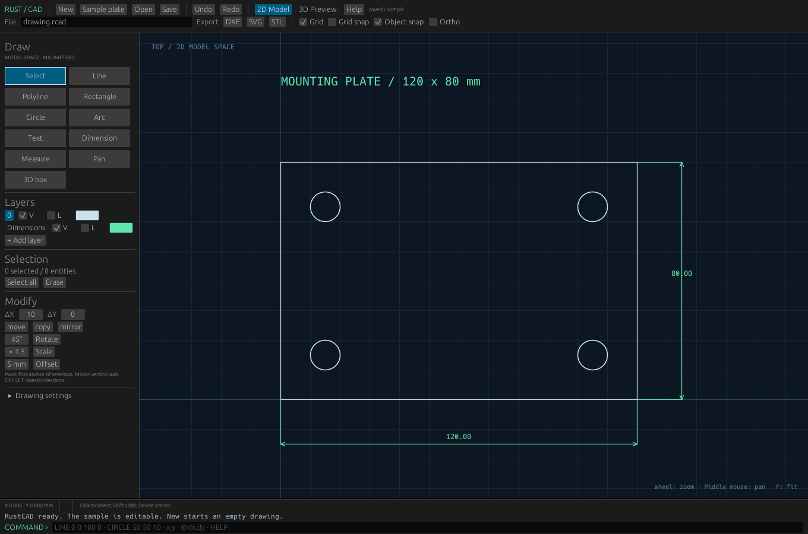

# RustCAD

An independent open-source CAD workbench written in Rust, with a native desktop editor and a dependency-free geometry/document core.

**Version 0.1.0 is a working prototype. It does not have feature parity with Autodesk AutoCAD.**



*Preview rendered from the actual egui interface during verification.*

## Implemented

- 2D model space, adaptive grid, pan, cursor-centered zoom and fit.
- Mouse drawing: line chains, open/closed polylines, rectangles, circles, center/start/end arcs, text and aligned dimensions.
- Exact absolute and relative coordinate input.
- Snaps: endpoints, midpoints, centers, quadrants and line/polyline intersections.
- Grid snap and orthographic drawing.
- Layers: visibility, locking and display colors.
- Selection, multi-selection, erase, move, copy, rotate, scale and vertical mirror.
- Offset for lines, circles and arcs.
- Command-line trim for a line against intersecting line/polyline segments.
- Undo/redo with up to 200 document checkpoints.
- Human-readable native RCAD documents.
- ASCII DXF import/export for the supported 2D entity subset.
- SVG export.
- Axis-aligned 3D boxes, adjustable wireframe camera and ASCII STL export.
- CLI sample generation and file conversion.

## Download

- **[Windows executable (x64)](https://github.com/Berserk-hub150/RustCAD/raw/refs/heads/main/windows/rust-cad.exe)**
- **[Complete package: Windows + source](https://github.com/Berserk-hub150/RustCAD/raw/refs/heads/main/downloads/RustCAD-0.1.0-Windows-and-Source.zip)**

## Windows

The distribution includes **`windows/rust-cad.exe` for Windows 10/11 x64**. Extract the ZIP and double-click it. No Rust installation is required to run the bundled executable. A graphical Windows run must still be checked on your PC.

To build from source:

1. Install Rust using [rustup](https://rustup.rs/). On Windows, follow the installer prompt for Microsoft C++ build tools.
2. Open PowerShell in the extracted project directory.
3. Run:

```powershell
powershell -ExecutionPolicy Bypass -File .\scripts\Start-RustCAD.ps1
```

Or use:

```text
cargo run -p rust-cad-desktop --locked
```

The first compilation downloads dependencies. Subsequent launches reuse the built application.

## Linux / macOS

Install Rust and platform development tools, then:

```text
cargo run -p rust-cad-desktop --locked
```

Linux needs an X11 or Wayland desktop and OpenGL support. macOS needs the Xcode command-line tools.

## First drawing

The app opens an editable 120 × 80 mm plate with four holes and two dimensions.

- Click **New** for an empty drawing.
- Choose a tool and click its points in model space.
- Use the **File** field for the full save/open path.
- Save native projects as RCAD; use the **DXF/SVG/STL** buttons to export.
- Export filenames use the File field's path with the chosen extension.
- Wheel zooms; middle mouse pans; **F** fits.
- **Escape** cancels; **Enter** finishes a polyline.
- **Ctrl+Z / Ctrl+Y** undo/redo; **Delete** erases selection.

Enter these commands separately in the bottom command field:

```text
RECT 0 0 120 80
CIRCLE 15 15 5
CIRCLE 105 15 5
CIRCLE 105 65 5
CIRCLE 15 65 5
DIM 0 0 120 0 -15
```

### Numeric commands

| Command | Example / behavior |
| --- | --- |
| LINE | LINE 0 0 100 0; LINE alone starts mouse drawing |
| CIRCLE | CIRCLE 50 50 10 |
| ARC | ARC 50 50 20 0 180 (degrees, counterclockwise) |
| RECT | RECT 0 0 120 80 |
| PLINE / CLOSE | Start a polyline; enter points; CLOSE completes a closed polyline |
| Coordinates | 10,20; @5,0 is relative to the last pending point |
| DIM | DIM 0 0 120 0 -15 |
| BOX | BOX 0 0 0 60 40 20 |
| SELECT | SELECT 1 2 selects IDs shown in the sidebar |
| MOVE / COPY | MOVE 10 5; COPY 30 0 |
| ROTATE / SCALE | ROTATE 45; SCALE 2 |
| MIRROR | Vertical axis through the first selected anchor |
| OFFSET | OFFSET 5; supports lines/circles/arcs |
| TRIM | TRIM target_id boundary_id keep_x keep_y |
| LAYER | LAYER Holes creates or activates a layer |
| OPEN / SAVE | OPEN examples/plate.dxf; SAVE drawing.rcad |
| EXPORT | EXPORT dxf; EXPORT svg; EXPORT stl |
| UNDO / REDO / ERASE | Document editing |
| 2D / 3D / HELP | View mode / command reference |

Rotate and scale use the first selected anchor as the pivot. 3D boxes remain axis-aligned and cannot be rotated by the 2D rotate command. Selection is performed in 2D.

## File compatibility

- RCAD retains supported entities, unit label, colors and layer state.
- DXF output uses ASCII R12 (AC1009).
- Import accepts LINE, CIRCLE, ARC, TEXT, POLYLINE/VERTEX and LWPOLYLINE.
- Bulged LWPOLYLINE segments become straight segments with a warning.
- Unsupported DXF entity types are reported and not preserved.
- Dimensions export as line/text geometry, not associative DXF DIMENSION entities.
- 3D boxes export as 3DFACE records; these are not supported by the importer.
- Native RGB colors are preserved in RCAD/SVG; DXF uses a default indexed color.
- DXF units/header metadata, advanced styles, blocks and paper space are not preserved.
- Binary DXF and DWG are unsupported.
- STL exports boxes only and fails explicitly if none exist.
- SVG can be opened in a browser or SVG editor.

See [FEATURES.md](FEATURES.md) for missing professional CAD functions.

## Project structure

```text
core/       Dependency-free geometry, documents, history and exchange
desktop/    Native egui/eframe editor
cli/        Sample generation and file conversion
examples/   RCAD, DXF and SVG reference drawing
scripts/    Launch/build helpers
```

```text
cargo test --workspace --locked
cargo build -p rust-cad-desktop --release --locked
cargo run -p rust-cad-cli -- sample examples
cargo run -p rust-cad-cli -- convert examples/plate.dxf drawing.svg
```

No cloud account or AI service is needed. The application does not upload drawings.

MIT license. Created for Luca Magrini.
